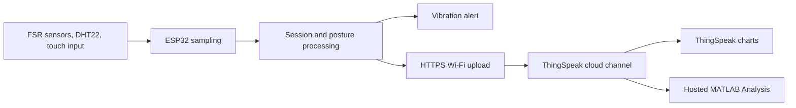

# IoT Smart Pillow for Sleep Posture Patterns and Local Sleep-Environment Analysis

## Project team

The source repository lists the following team members:

- Aaruni Choudhary — PES2UG24CS013
- Aditya Kumar — PES2UG24CS032
- Aditya Rao — PES2UG24CS034

## Abstract

This project uses an ESP32, three force-sensitive resistor (FSR) sensors, a DHT22 temperature/humidity sensor, a touch input, and a vibration motor driver to observe pressure distribution and the nearby environment. The ESP32 detects pillow-use sessions, labels readings as left-, center-, right-dominant, distributed, or no-pressure, and pulses a vibration alert when center-dominant pressure persists. The device uploads readings over Wi-Fi/HTTPS to a private ThingSpeak channel. ThingSpeak stores the data, provides field charts, and runs a hosted MATLAB Analysis script that summarizes recent pressure-category shares and changes, environmental averages, alert starts, and motor-on time. The results are descriptive and do not measure sleep quality.

## Problem statement and objectives

Sensor collection is useful when it answers a clear question. This prototype uses three pillow zones to describe changes in relative pressure distribution across use, while local temperature and humidity provide environmental context.

1. Detect pillow-use sessions and classify pressure distribution.
2. Compare relative pressure across the left, middle, and right zones.
3. Summarize category proportions and observed transitions in uploaded readings.
4. Describe local temperature and relative humidity.
5. Provide an optional pulsed motor alert after persistent center-dominant pressure and record its commanded state.
6. Store telemetry and run analysis in the cloud.

## Hardware

| Component | Pin | Function |
|---|---:|---|
| Left FSR | GPIO 35 | Analog pressure signal |
| Middle FSR | GPIO 32 | Analog pressure signal |
| Right FSR | GPIO 34 | Analog pressure signal |
| DHT22 | GPIO 27 | Temperature and humidity |
| Vibration driver input | GPIO 25 | Pulsed PWM feedback |
| Touch input | GPIO 14 | Marker, snooze, or dismissal |

The FSRs use voltage dividers. The motor uses an appropriate transistor/MOSFET or motor-driver module, a motor-rated supply, and shared ground. ESP32 input pins must stay within voltage limits. Refer to the physical build and module ratings for exact supply and resistor values.

## IoT pipeline

1. **Sense:** FSR voltage dividers, DHT22, and touch input capture pressure, local environment, and interaction.
2. **Ingest:** the cloud firmware samples every two seconds and uploads the latest sample over HTTPS every 16 seconds.
3. **Process:** firmware detects sessions, classifies pressure, triggers alerts, handles touch controls, and counts motor-on time.
4. **Store:** ThingSpeak stores successful updates in the project's private channel.
5. **Analyze:** ThingSpeak's hosted MATLAB Analysis reads a recent window and reports posture shares/transitions, mean temperature/humidity, observed alert starts, and the latest motor-on counter. Built-in field charts visualize the stored time series.

## Processing method

- A pressure session begins when any FSR reaches 500 ADC counts. It ends after pressure remains below threshold for three seconds.
- Each two-second sample is classified from the left, middle, and right readings. Center-dominant requires the middle sensor to meet its threshold and be at least as high as either side. Side-dominant is assigned to the stronger side when it exceeds the middle. Other pressure-present samples are distributed.
- Five seconds of persistent center-dominant pressure activates PWM duty 160 in a 250 ms on / 750 ms off pattern.
- One touch snoozes an active alert for ten seconds. Two touches dismiss the alert until posture changes. A touch with no active alert is a user marker.
- DHT22 failures are treated as invalid readings, not zero.

## Cloud data schema

The ThingSpeak channel uses eight numeric fields. Status text carries the current session number, system state, posture label, alert label, and latest event.

| Field | Meaning |
|---:|---|
| 1 | Left FSR ADC reading |
| 2 | Middle FSR ADC reading |
| 3 | Right FSR ADC reading |
| 4 | Temperature in Celsius |
| 5 | Relative humidity in percent |
| 6 | Posture code: 0 no pressure, 1 left, 2 center, 3 right, 4 distributed |
| 7 | Alert code: 0 off, 1 active, 2 snoozed, 3 dismissed |
| 8 | Cumulative motor-on seconds for current firmware session |

The cloud analysis covers its selected recent sample window; it does not reconstruct a full exact session from the status text. Since device samples arrive internally every two seconds but uploads are throttled, short movements or alert transitions can be missed by cloud analysis.

## Questions the analysis answers

- Which posture category occurred most often in the recent uploaded sample window?
- How many category transitions were observed between uploaded pressure-present samples?
- What mean temperature and humidity did the sensor report in that window?
- How many alert starts were visible, and what was the latest cumulative motor-on counter?

These are descriptive summaries. They do not prove a person was asleep, that a posture is harmful, or that the environment caused a health outcome.

## Validation plan

1. Verify session ID remains idle with no pressure.
2. Press each installed FSR separately and confirm its raw channel rises and the intended category appears.
3. Hold center pressure above threshold for more than five seconds and confirm active-alert status and motor pulses.
4. Test one-touch snooze and two-touch dismissal behavior.
5. Confirm a ThingSpeak response code of 200 and check field charts for expected values.
6. Run the cloud MATLAB Analysis and compare its output with the channel's recent data.

Record thresholds, sensor placement, and test conditions. Repeat sessions before drawing conclusions because FSR readings depend on placement.

## Results

Fill these values from actual ThingSpeak channel data and the MATLAB Analysis output after collecting sessions. Do not enter expected or simulated numbers.

- Number of sessions observed: **[record from channel status/session records]**
- Most frequent pressure category: **[fill from cloud analysis]**
- Observed category transitions: **[fill from cloud analysis]**
- Mean temperature and humidity: **[fill from cloud analysis]**
- Alert starts and motor response: **[fill from channel and physical observation]**

## Limitations and ethics

- FSR categories are approximate and depend on sensor position, resistor values, bedding, and thresholds.
- Cloud upload throttling reduces temporal resolution relative to firmware's two-second sampling. Disconnected readings are not backfilled.
- DHT22 measures the local microclimate and is not a clinical or sleep-stage sensor.
- Motor-on time logs firmware commands; only direct observation confirms actuator movement.
- Keep the ThingSpeak channel private and its API keys secret. Do not use this prototype for medical or safety decisions.

## Software deliverables

- `BioSync_Cloud/BioSync_Cloud.ino` — ESP32 sensing, processing, motor control, and cloud upload
- `cloud/ThingSpeak/MATLAB_Analysis.m` — hosted cloud analysis
- `cloud/ThingSpeak/README.md` — channel, dashboard, and analysis setup
- `BioSync_Cloud/secrets.h.example` — local credentials template
- `tools/serial_logger.py` and `tools/analyze_sessions.py` — optional offline analysis of serial telemetry
