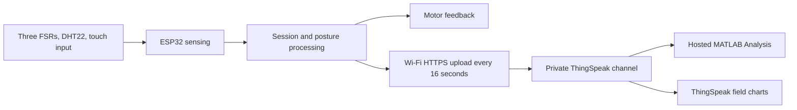

# BioSync Smart Pillow — Implementation

## Objective

Capture pillow pressure distribution and nearby temperature/humidity, summarize observed category patterns in the cloud, and provide a pulsed alert after sustained center-dominant pressure. This educational prototype does not diagnose sleep quality or health conditions.

## Hardware and firmware

| Signal | ESP32 pin | Method |
|---|---:|---|
| Left, middle, right FSR | GPIO 35, 32, 34 | ADC via existing voltage dividers |
| DHT22 | GPIO 27 | Temperature and relative humidity |
| Vibration driver input | GPIO 25 | PWM output |
| Touch input | GPIO 14 | Debounced user interaction |

The cloud firmware at `BioSync_Cloud/BioSync_Cloud.ino` uses the same sensor pins and motor control as the USB-serial firmware. A session starts when any FSR reaches the pressure threshold (default 500 ADC) and ends after three seconds without pressure. At two-second intervals, firmware classifies pressure as `LEFT_DOMINANT`, `CENTER_DOMINANT`, `RIGHT_DOMINANT`, `DISTRIBUTED`, or `NO_PRESSURE`. Five seconds of continuous center-dominant pressure activates a 250 ms on / 750 ms off motor pulse (PWM duty 160). One touch snoozes for ten seconds; two touches dismiss until posture changes.

## Cloud pipeline

1. **Sense:** FSR dividers, DHT22, and touch input collect physical and interaction data.
2. **Ingest:** ESP32 sends the latest values to ThingSpeak using HTTPS and a channel write key.
3. **Process:** firmware detects sessions, assigns pressure categories, manages alerts, and counts commanded motor-on time.
4. **Store:** ThingSpeak retains uploaded channel readings. A cloud update contains these fields: left FSR, middle FSR, right FSR, temperature, humidity, posture code, alert code, and cumulative motor-on seconds. Session number, system state, posture name, alert name, and latest event are also included in the channel status text.
5. **Analyze:** `cloud/ThingSpeak/MATLAB_Analysis.m` reads recent channel samples in ThingSpeak's MATLAB Analysis service and reports posture-category shares/transitions, environment means, observed alert starts, and the most recent motor-on counter. ThingSpeak's field charts visualize the time series.

## Analysis questions and limits

- Which pressure category was most common in the recent cloud sample window?
- How often did the observed category change between uploaded samples?
- What were the mean local temperature and humidity in that window?
- How many alert starts appeared in those samples, and what was the latest motor-on counter?

The script analyzes the selected recent channel window; it does not reconstruct session totals across the entire device session. Cloud updates are slower than two-second internal samples and can miss brief transitions. Sensor readings and motor PWM are not proof of sleep state or actual motor movement. FSR labels depend on the installed sensor position and threshold calibration. DHT22 readings describe the nearby environment only.

## Setup and validation

See `cloud/ThingSpeak/README.md` for channel creation, field names, local Wi-Fi/API credentials, Arduino libraries, firmware upload, and cloud analysis setup. Keep `secrets.h` private. Validate each FSR category, session start/end, alert pulse, touch behavior, cloud response code, and plotted field values before collecting report results. Do not include fabricated values; enter results from actual channel data.

## Software deliverables

- `BioSync_Cloud/BioSync_Cloud.ino` — ESP32 sensing, processing, actuation, and cloud upload
- `BioSync_Cloud/secrets.h.example` — local credentials template
- `cloud/ThingSpeak/MATLAB_Analysis.m` — cloud-hosted analysis
- `cloud/ThingSpeak/README.md` — cloud setup and dashboard guide
- `BioSync_Cloud/BioSync_Cloud.ino`, `tools/serial_logger.py`, and `tools/analyze_sessions.py` — optional USB-serial/offline workflow; the cloud sketch also emits serial telemetry
